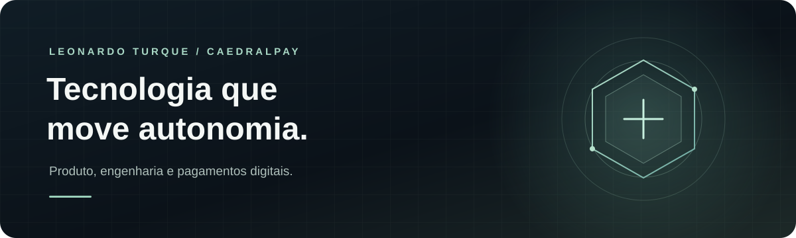

 

**Empreendedor &nbsp;·&nbsp; Engenharia de software &nbsp;·&nbsp; CaedralPay**

 

## Olá, eu sou Leonardo. 👋

Construo produtos e sistemas com uma ideia em mente: tecnologia financeira deve ser **acessível, clara e dar mais autonomia às pessoas**. Meu foco está na **CaedralPay**, conectando visão de produto, design e engenharia para transformar essa ideia em experiências reais.

## ✦ CaedralPay

  

A **CaedralPay** trabalha para aproximar pagamentos digitais e autocustódia de quem precisa de uma experiência simples. A plataforma apresenta soluções para receber pagamentos em stablecoins diretamente em uma carteira e integrar pagamentos por API.

A **CaedralPay Wallet** é uma carteira Android de autocustódia em desenvolvimento. Com uma interface nativa e proteção local das credenciais, ela foi pensada para que o usuário mantenha o controle das próprias chaves.

| Autonomia | Experiência | Engenharia |
| :--- | :--- | :--- |
| Controle das próprias chaves | Interface Android nativa | Proteção local e assinatura no dispositivo |

> A Wallet está em fase beta e segue em desenvolvimento.

## ⚙️ Tecnologias & ferramentas

Tecnologias que uso para construir interfaces, serviços e produtos digitais.

**Mobile & produto**

  
  
  

**Backend & desenvolvimento**

  
  
  
  
  

**Dados & infraestrutura**

  
  
  
  

---

**Construindo com propósito, pensando no futuro.**

[CaedralPay](https://caedral.com) &nbsp;·&nbsp; [GitHub](https://github.com/leonardo-turque) &nbsp;·&nbsp; [E-mail](mailto:leonardo.turque@hotmail.com)

